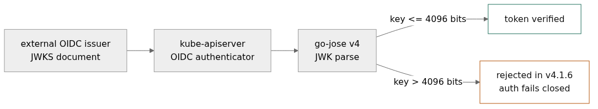

# The dependency bump is the easy part

**Author:** 0xkatana
**Tags:** kubernetes, security, supply-chain, cve, go

My first pull request to `kubernetes/kubernetes` merged on November 5. It fixes a CVE, and the code change is the least interesting part of it.

The diff is a version string. Twenty-eight files, +393/−191, and not a single hand edit:

```
hack/pin-dependency.sh github.com/go-jose/go-jose/v4 v4.1.7
hack/update-vendor.sh
```

`go.mod`, `go.sum`, the staging modules, the vendor tree. That is what a dependency bump looks like in a repository this size, and the scripts exist precisely so nobody does it by hand.

## What the CVE is

CVE-2026-116587 in go-jose v4.1.5: a crafted JWK carrying RSA parameters can make `rsa.PrivateKey.Validate` spend an unreasonable amount of CPU. Fixes landed in v4.1.6.

go-jose is not a leaf library in the API server. It signs and verifies service account tokens, it is used by the external JWT plugin and cluster-bootstrap, and the OIDC authenticator goes through it when it parses a JWKS from an external issuer. Which means the input is a document fetched from somewhere outside your cluster, and the parser is the thing being asked to do the expensive work.

That is the shape of every parser DoS: the attacker does not need an account, credentials or a route into the cluster. They need the issuer URL that the API server is already configured to trust, and a JSON file at the other end of it.



## The part the version string hides

v4.1.7 was not just the advisory fix. Patch releases in Go modules routinely carry behaviour changes, and this one did: **v4.1.6 rejects RSA moduli larger than 4096 bits.** Not a warning, a rejection. It applies to JWK parsing, to RSA keys inside `x5c` certificate chains, and to RSA private keys, with the limit exposed as `jose.MaxRSAModulusBits` for callers that want to raise it.

For the API server the practical consequence is small and specific: an external OIDC issuer publishing a key above 4096 bits stops authenticating. Keys that size are rare. No in-tree caller sets the variable. The in-tree service account keys are read as PEM or DER and never touch the JWK parser.

Small, specific, and the kind of small specific thing that should be in the release note rather than discovered by whoever owns that OIDC integration at 3am. That is why the release note in the PR says it:

```
JWK parsing now rejects RSA keys larger than 4096 bits, so an external OIDC
issuer that uses a larger key will stop authenticating.
```

## The review was about one question

The PR went up on October 31 with `/sig auth`. CLA signed, first-PR bot, `ok-to-test` from a reviewer the next working day, triage accepted. Then Jordan Liggitt read it and asked the only question that mattered: what happens to the over-limit key, and does this need a backport or an escape hatch.

Fair question, and my first answer was the boring one: nothing to backport. The release branches in scope still pull `coreos/go-oidc` v2.5.0 with `go-jose.v2`, so this change is master only.

The second half is where it got interesting. An escape hatch would mean a new environment variable or flag, a new permanent API nobody wants. The alternative is to treat an oversized key the way the code already treats an unsupported algorithm: skip it and move on, rather than failing the whole JWKS parse. RFC 7517 section 5 supports that reading. A key you cannot use is a key you ignore, not a reason to reject the document.

That fix has to be upstream, in go-oidc, because the skip is in the JWKS parser and k8s should not be patching that behaviour locally. go-jose also returns a plain error for a modulus over the limit, with no typed error to switch on, so go-oidc cannot distinguish "this key is too big" from "this key is broken".

I filed both:

- [go-jose#326](https://github.com/go-jose/go-jose/issues/326) — typed error for the modulus limit
- [go-oidc#510](https://github.com/coreos/go-oidc/issues/510) — skip the key the same way unsupported key types are skipped

`/lgtm` and `/approve` came the same afternoon. Merged at 16:09 UTC.

## What I would tell someone doing this for the first time

The mechanics are not the obstacle. Kubernetes has scripts for the bump, bots that check your CLA, and reviewers who will tell you what they want. First PR to a 1.5-million-line repository took five days from open to merge, and most of those were a weekend and a one-question thread.

The obstacle is that a patch release is not a one-line fix, even when the release note says "security fix". Read the module's full release notes, not just the advisory. If the patch changes behaviour, the k8s release note needs to say so in the user's terms, and the PR description needs to explain who is affected. Empty release notes are how a dependency bump becomes an incident two releases later.

Two smaller things:

`hack/pin-dependency.sh` and `hack/update-vendor.sh` are the whole change. If your diff has hand-edited vendor files, you did it wrong.

The AI disclosure field is a real field now, and answering it honestly costs nothing. Agents surveyed the advisories, ran the scripts, and cross-reviewed the diff. I read the change and signed it. That is the same standard I would apply to a junior engineer's PR, and the reviewer is entitled to know how the work was produced.

*The upstream issues are still open. If you maintain a JWKS parser and you have an opinion on skipping over-limit keys, [#510](https://github.com/coreos/go-oidc/issues/510) is the thread.*
